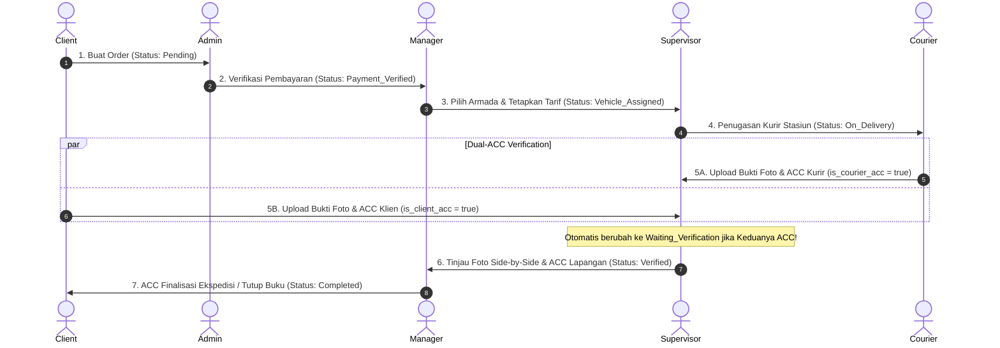

# Wire & Wagon — Dokumentasi Arsitektur & Spesifikasi API

Dokumentasi teknis resmi untuk sistem manajemen logistik dan ekspedisi **"Wire & Wagon"** (Era Revolusi Industri 1900-an).

Dokumen ini mencakup:
1. [Matriks Role-Based Access Control (RBAC)](#1-matriks-role-based-access-control-rbac)
2. [Skema Basis Data & Relasi Antar Model](#2-skema-basis-data--relasi-antar-model)
3. [Alur Operasional & State Machine "ACC"](#3-alur-operasional--state-machine-acc)
4. [Katalog Lengkap 23 REST API Endpoints](#4-katalog-lengkap-23-rest-api-endpoints)

---

## 1. Matriks Role-Based Access Control (RBAC)

Aplikasi mengimplementasikan 6 tingkatan peran (*roles*) dengan izin operasional yang terisolasi secara ketat:

| Fitur / Tindakan | `client` | `courier` | `admin` | `supervisor` | `manager` | `owner` |
|---|:---:|:---:|:---:|:---:|:---:|:---:|
| **Pendaftaran Publik** | ✅ | ❌ | ❌ | ❌ | ❌ | ❌ |
| **Buat Pesanan Kargo Baru** | ✅ | ❌ | ❌ | ❌ | ❌ | ❌ |
| **Lihat Riwayat Pesanan Sendiri** | ✅ | ✅ | ✅ | ✅ | ✅ | ✅ |
| **Lihat Seluruh Pesanan Sistem** | ❌ | ❌ | ✅ | ✅ | ✅ | ✅ |
| **Batalkan Pesanan (Status: Pending)** | ✅ | ❌ | ✅ | ❌ | ❌ | ❌ |
| **Verifikasi Pembayaran Kargo** | ❌ | ❌ | ✅ | ❌ | ❌ | ❌ |
| **Catat Tiket Komplain / Kendala** | ❌ | ❌ | ✅ | ❌ | ❌ | ❌ |
| **Alokasi Armada 1900 & Tarif (ACC Kendaraan)** | ❌ | ❌ | ❌ | ❌ | ✅ | ❌ |
| **Penugasan Kurir Stasiun** | ❌ | ❌ | ❌ | ✅ | ❌ | ❌ |
| **Kirim Bukti Foto Kurir & ACC Serah Terima** | ❌ | ✅ | ❌ | ❌ | ❌ | ❌ |
| **Kirim Bukti Foto Klien & ACC Penerimaan** | ✅ | ❌ | ❌ | ❌ | ❌ | ❌ |
| **Audit Foto Berdampingan & ACC Verifikasi Lapangan** | ❌ | ❌ | ❌ | ✅ | ❌ | ❌ |
| **ACC Finalisasi Ekspedisi (Tutup Buku)** | ❌ | ❌ | ❌ | ❌ | ✅ | ❌ |
| **Laporan Analitik Keuangan Treasury** | ❌ | ❌ | ❌ | ❌ | ✅ | ✅ |
| **Manajemen Inventaris Armada (Tambah/Hapus)** | ❌ | ❌ | ❌ | ❌ | ❌ | ✅ |
| **Manajemen Kredensial Staf Stasiun** | ❌ | ❌ | ❌ | ❌ | ✅ | ✅ |

---

## 2. Skema Basis Data & Relasi Antar Model

### A. Model `User` (`Users`)
Menyimpan identitas seluruh entitas pengguna, baik saudagar (client) maupun seluruh jajaran staf stasiun ekspedisi.

| Kolom | Tipe Data | Keterangan |
|---|---|---|
| `id` | `INTEGER` | Primary Key, Auto Increment |
| `username` | `STRING` | Unique, Not Null |
| `email` | `STRING` | Unique, Not Null, Format Email Valid |
| `password` | `STRING` | Not Null, di-hash via bcrypt (Salt 10) |
| `role` | `ENUM` | Nilai: `'client'`, `'courier'`, `'admin'`, `'supervisor'`, `'manager'`, `'owner'`. Default: `'client'` |
| `createdAt` | `DATE` | Timestamp pembuatan akun |
| `updatedAt` | `DATE` | Timestamp pembaharuan akun |

### B. Model `Vehicle` (`Vehicles`)
Menyimpan daftar armada transportasi era 1900-an yang dapat dialokasikan untuk pengiriman barang.

| Kolom | Tipe Data | Keterangan |
|---|---|---|
| `id` | `INTEGER` | Primary Key, Auto Increment |
| `name` | `STRING` | Nama armada (e.g. *Bicycle Messenger*, *Steam Locomotive*) |
| `type` | `STRING` | Jenis teritori: `In-City`, `Inter-City`, `River` |
| `capacity_kg` | `INTEGER` | Daya angkut maksimum dalam kilogram |
| `cost_per_km` | `INTEGER` | Biaya operasional dasar per kilometer (Rupiah) |
| `is_available` | `BOOLEAN` | Status kesiapan armada (Default: `true`) |

### C. Model `Order` (`Orders`)
Menyimpan waybill manifest pengiriman kargo dan mencatat seluruh riwayat tahapan ACC.

| Kolom | Tipe Data | Keterangan |
|---|---|---|
| `id` | `INTEGER` | Primary Key, Auto Increment |
| `receipt_number` | `STRING` | Unique, Not Null (Format otomatis: `WW-1900-XXXX`) |
| `clientId` | `INTEGER` | Foreign Key &rarr; `Users.id` (Wajib ada) |
| `courierId` | `INTEGER` | Foreign Key &rarr; `Users.id` (Nullable, diisi oleh Supervisor) |
| `supervisorId` | `INTEGER` | Foreign Key &rarr; `Users.id` (Nullable, diisi saat dispatch/audit) |
| `managerId` | `INTEGER` | Foreign Key &rarr; `Users.id` (Nullable, diisi saat alokasi armada/finalisasi) |
| `vehicleId` | `INTEGER` | Foreign Key &rarr; `Vehicles.id` (Nullable, diisi oleh Manager) |
| `origin` | `STRING` | Stasiun / pasar asal pengiriman |
| `destination` | `STRING` | Gudang / pelabuhan tujuan pengiriman |
| `route_type` | `ENUM` | Nilai: `'in_city'`, `'inter_city'` |
| `item_name` | `STRING` | Nama komoditas barang kargo |
| `weight_kg` | `INTEGER` | Bobot muatan dalam kilogram |
| `price` | `INTEGER` | Total tarif ongkos kirim (Default: 0) |
| `is_paid` | `BOOLEAN` | Status pelunasan faktur (Default: false) |
| `is_courier_acc` | `BOOLEAN` | Tanda ACC penyerahan dari Kurir (Default: false) |
| `courier_proof_url` | `STRING` | Tautan URL bukti foto serah terima kurir |
| `is_client_acc` | `BOOLEAN` | Tanda ACC penerimaan dari Klien (Default: false) |
| `client_proof_url` | `STRING` | Tautan URL bukti foto penerimaan klien |
| `is_supervisor_acc` | `BOOLEAN` | Tanda ACC verifikasi inspektur lapangan (Default: false) |
| `is_manager_final_acc` | `BOOLEAN` | Tanda ACC tutup buku operasional manager (Default: false) |
| `status` | `ENUM` | `'Pending'`, `'Payment_Verified'`, `'Vehicle_Assigned'`, `'On_Delivery'`, `'Waiting_Verification'`, `'Verified'`, `'Completed'`, `'Cancelled'` |
| `issue_notes` | `TEXT` | Catatan koreksi alamat / komplain stasiun |

---

## 3. Alur Operasional & State Machine "ACC"



---

## 4. Katalog Lengkap 23 REST API Endpoints

Seluruh endpoint privat membutuhkan header:
```http
Authorization: Bearer <access_token>
```

---

### A. Auth Routes (`/api/auth`)

#### 1. Registrasi Client Baru
* **Route:** `POST /api/auth/register`
* **Role:** Publik
* **Request Body:**
  ```json
  {
    "username": "merchant_batavia",
    "email": "merchant@batavia.com",
    "password": "password123"
  }
  ```
* **Response (201 Created):**
  ```json
  {
    "statusCode": 201,
    "message": "Client registered successfully",
    "access_token": "eyJhbGciOiJIUzI1NiIsInR5c...",
    "user": {
      "id": 7,
      "username": "merchant_batavia",
      "email": "merchant@batavia.com",
      "role": "client"
    }
  }
  ```

#### 2. Autentikasi Pengguna (Login)
* **Route:** `POST /api/auth/login`
* **Role:** Publik
* **Request Body:**
  ```json
  {
    "username": "admin1",
    "password": "password123"
  }
  ```
* **Response (200 OK):**
  ```json
  {
    "statusCode": 200,
    "message": "Login successful",
    "access_token": "eyJhbGciOiJIUzI1NiIsInR5c...",
    "user": {
      "id": 3,
      "username": "admin1",
      "email": "admin1@wirewagon.com",
      "role": "admin"
    }
  }
  ```

#### 3. Profil Pengguna Aktif
* **Route:** `GET /api/auth/me`
* **Role:** Semua Pengguna Terautentikasi
* **Response (200 OK):** Mengembalikan data user `{ id, username, email, role, createdAt }`.

---

### B. User & Staff Management Routes (`/api/users`)

#### 4. Melihat Daftar Pengguna
* **Route:** `GET /api/users`
* **Role:** `manager`, `owner`, `supervisor`
* **Query Params (Opsional):** `?role=courier` (Filter khusus kurir).
* **Response (200 OK):** Array daftar pengguna stasiun.

#### 5. Menambah Akun Staf Baru
* **Route:** `POST /api/users`
* **Role:** `manager`, `owner`
* **Request Body:**
  ```json
  {
    "username": "courier2",
    "email": "courier2@wirewagon.com",
    "password": "password123",
    "role": "courier"
  }
  ```
* **Response (201 Created):** Mengembalikan detail akun staf yang baru diterbitkan.

#### 6. Menghapus Akun Pengguna
* **Route:** `DELETE /api/users/:id`
* **Role:** `owner`
* **Response (200 OK):** Konfirmasi penghapusan akun.

---

### C. Vehicle Fleet Routes (`/api/vehicles`)

#### 7. Mendapatkan Daftar Armada
* **Route:** `GET /api/vehicles`
* **Role:** Semua Pengguna Terautentikasi
* **Response (200 OK):** Array objek kendaraan era 1900-an beserta kapasitas muatan dan biaya per km.

#### 8. Menambah Armada Kendaraan Baru
* **Route:** `POST /api/vehicles`
* **Role:** `manager`, `owner`
* **Request Body:**
  ```json
  {
    "name": "Steam Locomotive No. 9",
    "type": "Inter-City",
    "capacity_kg": 60000,
    "cost_per_km": 180
  }
  ```

#### 9. Memperbarui Kesiapan Armada
* **Route:** `PUT /api/vehicles/:id`
* **Role:** `manager`, `owner`
* **Request Body:** `{ "is_available": false }` (contoh: masuk bengkel perawatan).

#### 10. Menghapus Armada dari Inventaris
* **Route:** `DELETE /api/vehicles/:id`
* **Role:** `owner`

---

### D. Order Operational Routes (`/api/orders`)

#### 11. Membuat Pesanan Kargo Baru
* **Route:** `POST /api/orders`
* **Role:** `client`
* **Request Body:**
  ```json
  {
    "origin": "Stasiun Kota A",
    "destination": "Dermaga Pelabuhan B",
    "route_type": "in_city",
    "item_name": "Bal Kapas & Sutra",
    "weight_kg": 150
  }
  ```
* **Status Awal:** Otomatis berstatus `'Pending'`.

#### 12. Melihat Daftar Manifest Pesanan
* **Route:** `GET /api/orders`
* **Role:** Semua Pengguna Terautentikasi
* **Penyaringan Otomatis:**
  - `client`: Hanya order dengan `clientId === req.user.id`.
  - `courier`: Hanya order dengan `courierId === req.user.id`.
  - `admin`, `supervisor`, `manager`, `owner`: Melihat seluruh pesanan beserta relasi asosiasinya.

#### 13. Rincian Satu Pesanan
* **Route:** `GET /api/orders/:id`
* **Role:** Terautentikasi (dengan validasi kepemilikan bagi client/courier).

#### 14. Verifikasi Pembayaran Faktur
* **Route:** `PUT /api/orders/:id/verify-payment`
* **Role:** `admin`
* **Prasyarat Status:** `'Pending'`.
* **Efek:** Mengubah `is_paid = true` dan `status = 'Payment_Verified'`.

#### 15. Mencatat Tiket Komplain / Kendala
* **Route:** `PUT /api/orders/:id/issue`
* **Role:** `admin`
* **Request Body:** `{ "issue_notes": "Alamat tujuan dikoreksi ke Gudang Timur" }`

#### 16. Membatalkan Pesanan
* **Route:** `PUT /api/orders/:id/cancel`
* **Role:** `client` (pemilik), `admin`
* **Prasyarat Status:** Hanya pesanan berstatus `'Pending'`.

---

### E. The "ACC" Workflow Routes (`/api/acc`)

#### 17. Manager ACC: Alokasi Kendaraan & Tarif
* **Route:** `PUT /api/acc/:orderId/manager-vehicle`
* **Role:** `manager`
* **Prasyarat Status:** `'Payment_Verified'`
* **Request Body:**
  ```json
  {
    "vehicleId": 3,
    "price": 75000
  }
  ```
* **Status Baru:** `'Vehicle_Assigned'`.

#### 18. Supervisor ACC: Penugasan Kurir Lapangan
* **Route:** `PUT /api/acc/:orderId/supervisor-assign`
* **Role:** `supervisor`
* **Prasyarat Status:** `'Vehicle_Assigned'`
* **Request Body:** `{ "courierId": 2 }`
* **Status Baru:** `'On_Delivery'`.

#### 19. Courier ACC: Selesai Pengiriman & Unggah Bukti
* **Route:** `PUT /api/acc/:orderId/courier-deliver`
* **Role:** `courier` (kurir yang ditugaskan)
* **Prasyarat Status:** `'On_Delivery'`
* **Request Body:** `{ "courier_proof_url": "https://example.com/courier-photo.jpg" }`
* **Logika Otorisasi Ganda:** Set `is_courier_acc = true`. Jika klien juga sudah ACC, status otomatis beralih menjadi `'Waiting_Verification'`.

#### 20. Client ACC: Konfirmasi Penerimaan & Unggah Bukti
* **Route:** `PUT /api/acc/:orderId/client-receive`
* **Role:** `client` (pemilik pesanan)
* **Prasyarat Status:** `'On_Delivery'`
* **Request Body:** `{ "client_proof_url": "https://example.com/client-photo.jpg" }`
* **Logika Otorisasi Ganda:** Set `is_client_acc = true`. Jika kurir juga sudah ACC, status otomatis beralih menjadi `'Waiting_Verification'`.

#### 21. Supervisor ACC: Verifikasi Lapangan Bukti Ganda
* **Route:** `PUT /api/acc/:orderId/supervisor-verify`
* **Role:** `supervisor`
* **Prasyarat Status:** `'Waiting_Verification'` (kedua URL foto wajib ada)
* **Status Baru:** `'Verified'`.

#### 22. Manager ACC: Finalisasi Tutup Buku
* **Route:** `PUT /api/acc/:orderId/manager-finalize`
* **Role:** `manager`
* **Prasyarat Status:** `'Verified'`
* **Status Baru:** `'Completed'` (Tarif resmi dibukukan ke pendapatan perbendaharaan).

#### 23. Analitik Perbendaharaan Stasiun
* **Route:** `GET /api/acc/analytics`
* **Role:** `owner`, `manager`
* **Response (200 OK):**
  ```json
  {
    "statusCode": 200,
    "data": {
      "totalRevenue": 2450000,
      "totalCompleted": 18,
      "totalActiveOrders": 5,
      "ordersByStatus": [ ... ],
      "shipmentsPerVehicle": [ ... ]
    }
  }
  ```
